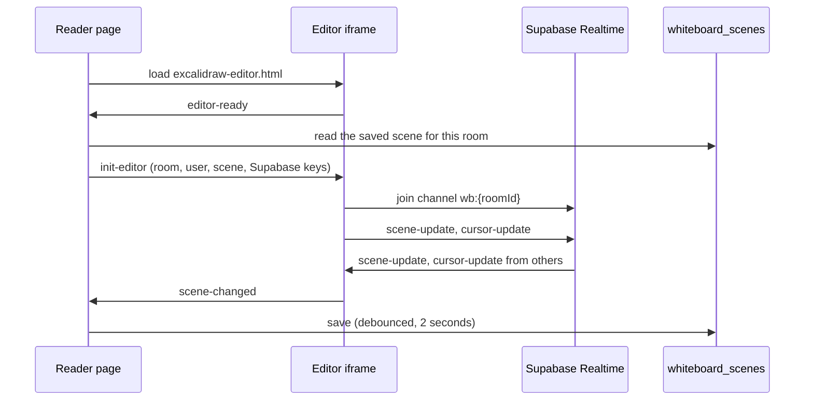

---
icon:
  type: fluent:whiteboard-24-filled
---

# Whiteboards

*Excalidraw whiteboards in a course: a learning object, and a course-wide board*

---

[[toc]]

---

Tutors includes whiteboards built on [Excalidraw](https://excalidraw.com/). There are two of them, and they behave differently:

| | Whiteboard learning object | Course whiteboard |
| --- | --- | --- |
| Where | A card in a topic, opened on its own page | An icon in the course navigator, opens a fullscreen overlay |
| Content | Starts from a diagram you author | Starts empty |
| Enabled by | Adding a `whiteboard-*` folder | `whiteboard: 1` in `properties.yaml` |
| Saved | Yes, per room | No |

# The whiteboard learning object

## Authoring

Add a folder whose name starts with `whiteboard-` to a topic or unit, and put an `.excalidraw` file in it. Create the file at [excalidraw.com](https://excalidraw.com/) and use *Save to* to download it.

~~~
topic-01-diagrams/
  whiteboard-design/
    whiteboard.md
    design.excalidraw
~~~

`whiteboard.md` supplies the title, in the same way as the other learning objects:

~~~markdown
# System Design
~~~

If the folder holds more than one `.excalidraw` file, the first one is used. Regenerate the course with the Tutors generator and the card appears in the topic.

## What learners see

Above the diagram is a small toolbar:

| Button | What it does |
| --- | --- |
| **Edit** | Swaps the read-only view for the full Excalidraw editor. Click again to go back to the view. |
| **Personal / Shared** | Only shown while editing. Switches between your own board and one shared by everyone. |
| **Fullscreen** | Fills the browser window. |

**View mode** shows your original `.excalidraw` file as a picture. Learners can drag to pan and use the mouse wheel to zoom. It never changes.

**Edit mode** opens the full editor, with all of the Excalidraw tools. Changes are shared live with anyone else in the same room, with their cursors visible.

Leaving edit mode returns to your original diagram. This is deliberate: what you authored stays the reference, and learners' edits live alongside it.

## Personal and shared boards

- **Personal** (closed padlock): a board that belongs to the signed-in user. Edits are private, and come back the next time that user opens it.
- **Shared** (open padlock, green): one board for everyone who opens this whiteboard. Everyone sees each other's edits and cursors as they happen.

Both start from your authored diagram the first time they are opened.

# The course whiteboard

The course whiteboard is a general-purpose board for the whole course. It is not attached to any learning object. It is useful for a live class, an online tutorial or a quick sketch during a discussion.

Enable it in the course's `properties.yaml`:

~~~yaml
whiteboard: 1
~~~

An icon then appears in the course navigator, next to Search. Selecting it opens Excalidraw in a fullscreen overlay with a **Close** button (the Escape key also closes it). Everyone who opens the overlay in the same course shares one board.

A few things to know:

- The value must be the number `1`. `true`, `"1"` or leaving the property out keeps the button hidden.
- The button is only shown on desktop-sized screens.
- The board is **not saved**. Changes are shared live between the people who have it open, but when the overlay is closed or the page is reloaded the board is cleared, and someone arriving later starts with an empty canvas.
- The `whiteboard: 1` property does not affect whiteboard learning objects, which do not need it.

# What it needs

Whiteboards use the same Supabase project as the rest of Tutors, and an internet connection: Excalidraw itself is loaded from [esm.sh](https://esm.sh/).

- Live sharing uses Supabase Realtime, so the reader needs `PUBLIC_SUPABASE_URL` and `PUBLIC_SUPABASE_ANON_KEY`.
- Saving uses a `whiteboard_scenes` table in the database. The SQL to create it is in the Tutors monorepo, in `packages/svelte/utils/rbac/sql/003_whiteboard_scenes.sql`.
- With `PUBLIC_ANON_MODE=TRUE` nothing is saved or restored.

Only the drawing itself is saved: the shapes, text and lines and the background colour. Images pasted into a board are not.

# How it works

*This section is for people working on Tutors itself.*

The reader page never draws the whiteboard itself. It embeds one of two small static pages in an iframe, and talks to it with `postMessage`:

| File | Used for |
| --- | --- |
| `excalidraw-viewer.html` | Renders a scene to SVG, with pan and zoom |
| `excalidraw-editor.html` | The full Excalidraw editor, plus the Supabase Realtime connection |

Both files load Excalidraw and React from esm.sh, so no bundling is involved.

The iframe announces itself with `viewer-ready` or `editor-ready` once it has loaded, and the page replies with what it needs: the scene to draw, or the room, the user and the Supabase settings to join. The iframe is created again whenever the mode changes or a learner switches between the personal and shared board, so each board starts with a fresh handshake.

## Rooms

Each board is a Supabase Realtime channel named `wb:{roomId}`. The room ids are:

| Board | Room id |
| --- | --- |
| Personal | `wb-{courseId}-{route}-{userId}` |
| Shared | `wb-{courseId}-{route}` |
| Course whiteboard | `wb-{courseId}-shared` |

## Merging edits

The editor sends only the elements that changed. When elements arrive from someone else, they are merged by element id, and the higher Excalidraw `version` number wins. Cursor positions travel on a separate event. Supabase Presence tracks who is in the room, so a collaborator's cursor disappears when they leave.

## More detail

The [whiteboard guide](https://github.com/tutors-sdk/tutors-mono-repo/blob/main/guides/WHITEBOARD.md) in the Tutors monorepo describes the components and message formats, and how to try a whiteboard against a course on your own machine.
